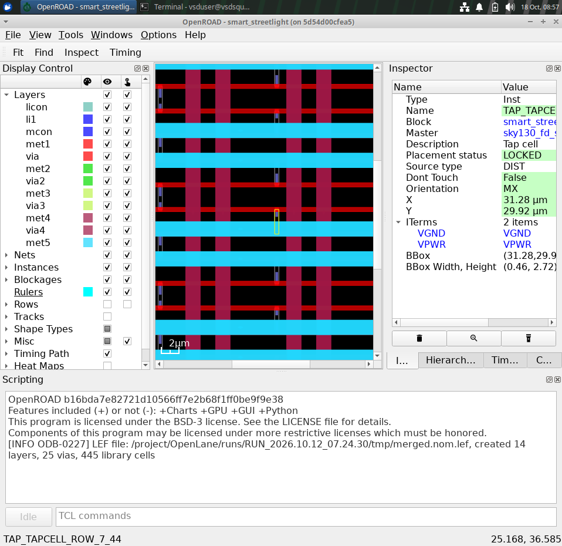
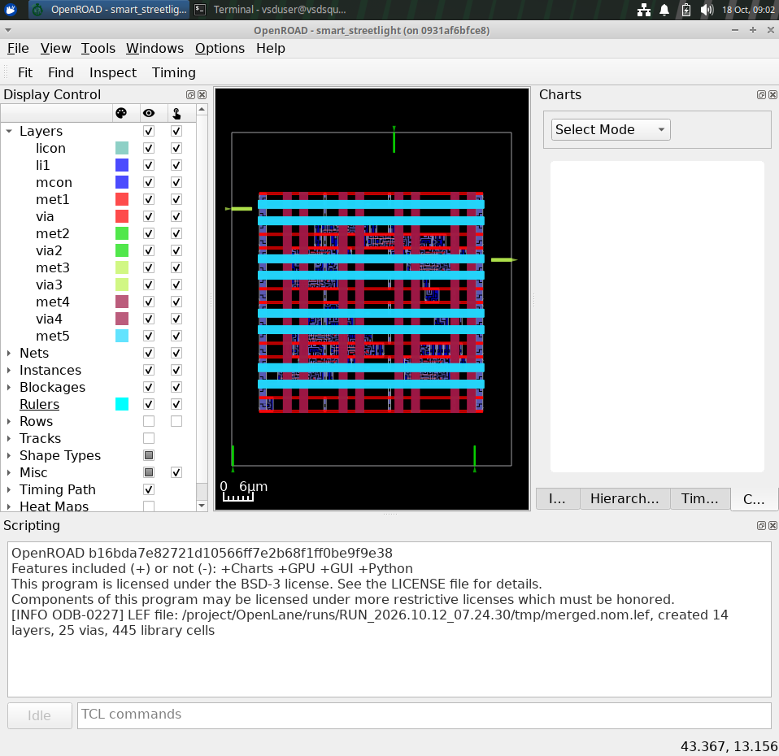
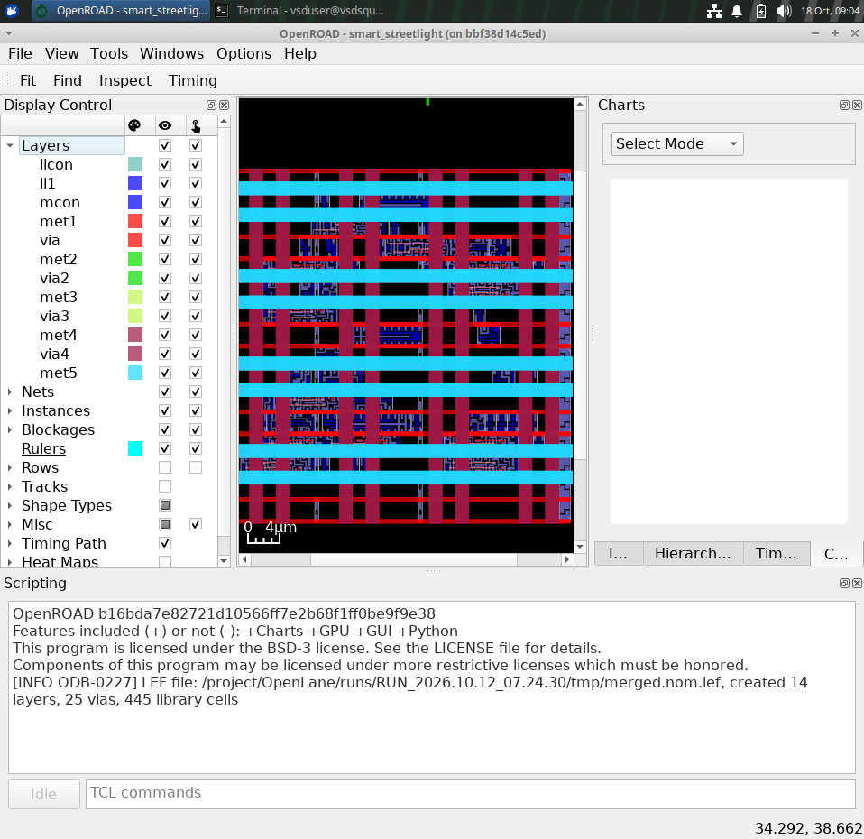
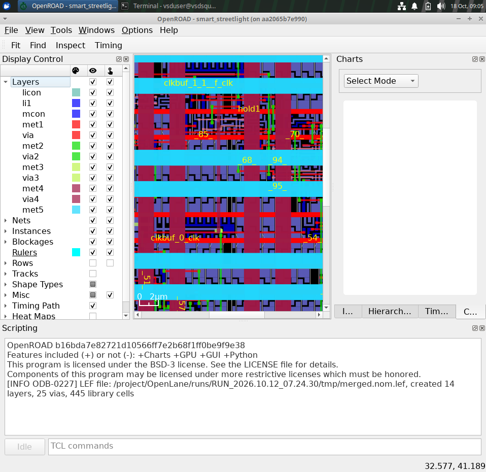
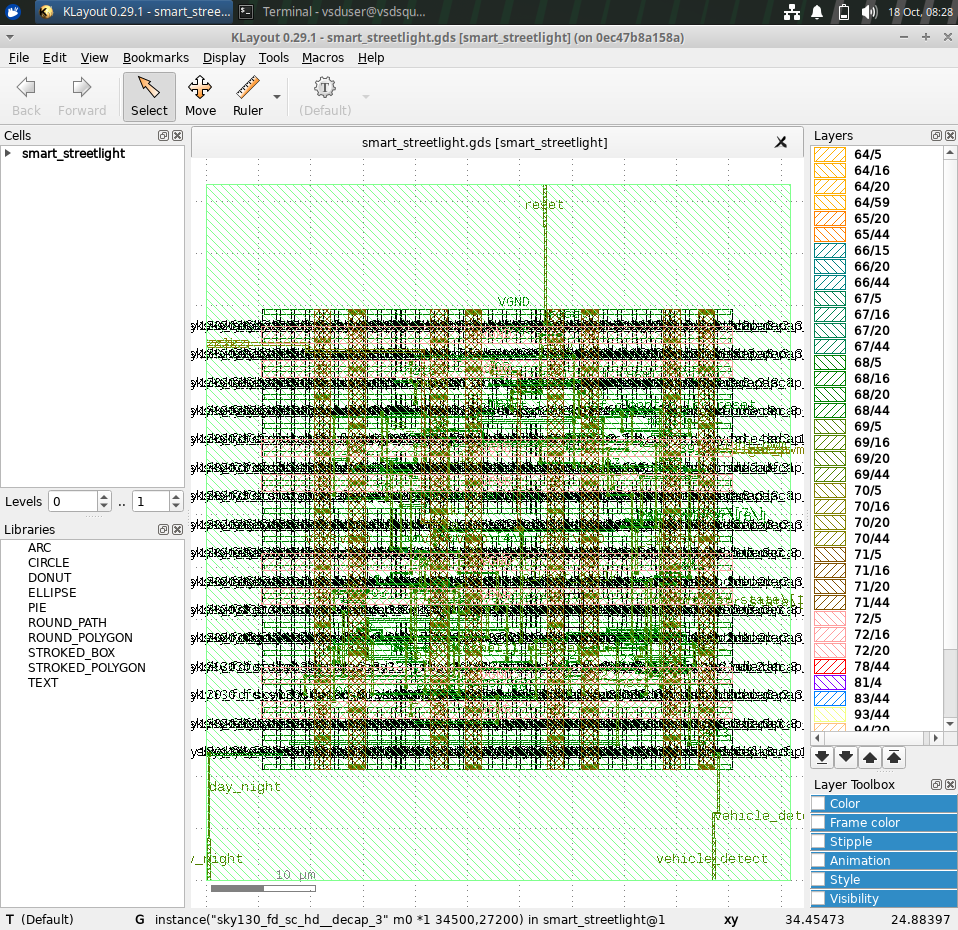

# Smart Streetlight Controller Using Verilog HDL

## 1. Project Overview

The Smart Streetlight Controller is a digital design project developed using Verilog HDL. It controls streetlight intensity based on day/night conditions and vehicle detection.

The design uses sequential logic to manage the controller's operating states and Pulse Width Modulation (PWM) to control light intensity. The project explores the digital-design flow from RTL development and simulation to synthesis, physical design, and static timing analysis.

## 2. Objectives

- Design a sequential streetlight controller using Verilog HDL.
- Implement day/night operation using a finite-state machine (FSM).
- Control light intensity through PWM.
- Reduce unnecessary illumination during daytime.
- Increase illumination when a vehicle is detected at night.
- Perform RTL simulation and logic synthesis.
- Explore floorplanning, placement, clock tree synthesis, routing, and final layout generation.
- Examine static timing analysis across multiple timing corners.

## 3. Design Description

The controller uses day/night status and vehicle detection as inputs to determine the required light intensity.

### Operating Conditions

| Operating condition | Expected light output |
|---|---|
| Daytime | Light OFF |
| Nighttime, no vehicle detected | Dim illumination |
| Nighttime, vehicle detected | Full illumination |

In the implemented design, the PWM output is configured for three operating levels:

- `0`: Light OFF.
- `77`: Approximately 30% duty cycle.
- `255`: Full duty cycle for an 8-bit PWM control value.

These values represent the PWM control levels used by the design; the actual physical brightness depends on the connected driver and light source.

## 4. RTL Architecture

The design is organized into Verilog modules to make the implementation easier to understand, test, and maintain.

### Main modules

- **Smart Streetlight Top Module:** Integrates the controller and supporting modules.
- **Streetlight Controller:** Implements the control logic and operating states.
- **PWM Generator:** Produces a PWM signal for light-intensity control.
- **Reset Synchronizer:** Provides reset synchronization for the design.

### Functional flow

```text
Day/Night Status
       |
       v
Streetlight Controller <--- Vehicle Detection
       |
       v
   PWM Control
       |
       v
Streetlight Output
```

## 5. Tools and Technologies

- Verilog HDL
- Icarus Verilog
- GTKWave
- Yosys
- OpenLane
- OpenROAD
- SkyWater SKY130 platform
- Static Timing Analysis (STA)
- Linux and Docker

## 6. RTL Simulation

RTL simulation is used to verify the controller's logical behavior before synthesis.

The testbench applies different day/night and vehicle-detection conditions and checks the controller's response.

### Simulation procedure

1. Compile the RTL files and testbench using Icarus Verilog.
2. Run the generated simulation executable.
3. Generate a VCD waveform file.
4. Open the waveform using GTKWave.
5. Inspect the controller states, inputs, and PWM output.

Example commands, run from the project directory:

```bash
iverilog -o streetlight_sim \
  RTL/smart_streetlight.v \
  RTL/streetlight_controller.v \
  RTL/pwm_generator.v \
  RTL/reset_sync.v \
  Testbench/streetlight_tb.v

vvp streetlight_sim
gtkwave streetlight.vcd
```

If your testbench uses a different VCD filename or module interface, adjust the commands to match the actual source files.

## 7. Logic Synthesis

Logic synthesis converts the RTL design into a gate-level netlist using Yosys.

The synthesis flow maps the design to standard cells supported by the selected technology library.

### Main activities

- Read the RTL source files.
- Elaborate the top-level design.
- Perform logic optimization.
- Map the logic to standard cells.
- Generate a synthesized netlist.
- Review the synthesis log and cell statistics.

The generated netlist serves as an input to the physical-design flow.

## 8. Physical Design Flow

The project explores physical implementation using OpenLane and OpenROAD with the SkyWater SKY130 platform.

The main stages are:

1. Floorplanning
2. Power planning
3. Standard-cell placement
4. Clock Tree Synthesis (CTS)
5. Routing
6. Design-rule and layout checks
7. Final GDSII generation

### 8.1 Floorplanning

Floorplanning defines the die and core regions and establishes the initial physical organization of the design. It provides the foundation for power planning, placement, and routing.



### 8.2 Standard-Cell Placement

Placement assigns physical locations to standard cells inside the core. The placement stage aims to support timing requirements, connectivity, and efficient area utilization.



### 8.3 Clock Tree Synthesis (CTS)

Clock Tree Synthesis builds the clock distribution network for sequential elements. The clock network is designed to distribute the clock signal while managing clock latency and skew.



### 8.4 Routing

Routing connects cells and pins using the available metal layers and vias. It implements the electrical connections needed for the design to operate after physical implementation.



### 8.5 Final GDSII Layout

GDSII is a layout data format used to represent physical geometry on semiconductor process layers. The final layout file can be opened in a layout viewer for inspection.



*The screenshots document the saved implementation stages. Their visual appearance depends on the selected database, displayed layers, and viewer settings.*

## 9. Static Timing Analysis (STA)

Static Timing Analysis evaluates whether the design satisfies timing constraints without requiring input-vector simulation.

The project includes timing reports for three timing corners:

- **FF (Fast-Fast):** Represents a fast-process timing condition.
- **TT (Typical-Typical):** Represents a typical-process timing condition.
- **SS (Slow-Slow):** Represents a slow-process timing condition.

The analysis examines setup and hold timing, slack, and timing-path behavior under the configured constraints.

### Recorded timing summary

| Timing corner | Setup slack | Hold slack |
|---|---:|---:|
| FF | 4.03 ns | 0.12 ns |
| TT | 4.02 ns | 0.12 ns |
| SS | 4.03 ns | 0.12 ns |

The saved reports show zero WNS and TNS for the reported timing analysis. These values should be interpreted in the context of the specific constraints, libraries, and timing configuration used in the run.

## 10. Physical Verification

The project includes saved design-rule and layout-versus-schematic reports.

- **DRC:** The saved report records a count of zero violations.
- **LVS:** The saved report records zero total errors and no reported net, device, pin, or property mismatches.

The implementation was run with a PDK-version mismatch override. Therefore, these results are intended for academic learning and demonstration, not as a claim of foundry-qualified manufacturing signoff.

## 11. Results and Learning Outcomes

The project demonstrates the main stages of a digital-design implementation workflow:

- Sequential RTL design using Verilog HDL.
- FSM-based control logic.
- PWM-based light-intensity control.
- Functional simulation and waveform inspection.
- Logic synthesis and standard-cell mapping.
- Floorplanning, placement, CTS, and routing.
- Static timing analysis across multiple corners.
- Inspection of physical layout and verification reports.

The project provides practical experience connecting RTL design decisions with their synthesized and physically implemented representations.

## 12. Future Enhancements

Possible improvements include:

- Adding ambient-light sensor input.
- Adding a configurable PWM intensity level.
- Supporting multiple streetlight zones.
- Adding fault detection and emergency operating modes.
- Improving power estimation and timing optimization.
- Repeating physical verification with a fully matched PDK and tool configuration.

## 13. Conclusion

The Smart Streetlight Controller demonstrates how a sequential digital control system can be developed using Verilog HDL and explored through an open-source EDA flow. Simulation, synthesis, physical implementation, and static timing analysis help connect the functional design with its hardware realization.

The project serves as an academic demonstration of RTL-to-layout concepts and provides a foundation for further work in digital design and VLSI physical design.

---

**Project:** Smart Streetlight Controller  
**Design language:** Verilog HDL  
**Implementation platform:** SkyWater SKY130  
**EDA flow:** Yosys, OpenLane, OpenROAD  
**Analysis:** Simulation, synthesis, physical design, and multi-corner STA
